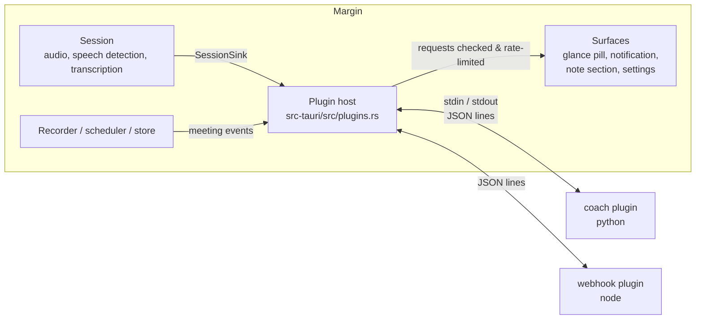

# Margin plugins — design

Status: proposal (20 Nov 2026). Nothing here is built yet.
First plugin: the talk coach ("you've been talking 2:30, wrap up").

## Why

Margin's core should stay small, fast and boring: capture, transcribe, write notes, find them again.
Ideas like the talk coach, CRM sync or a Slack digest are useful to some people and noise to others.
Plugins let those live outside the core. People can also have a coding agent write one for their
own habits ("flag me when I say 'basically' too much") without touching Margin itself.

## Priorities, in order

1. **Reliability.** A plugin can never stop, slow or corrupt a recording. If a plugin hangs,
   crashes or floods Margin with requests, the recording carries on and the plugin gets switched off.
2. **Performance.** With no plugins installed, Margin does no extra work. Each running plugin adds
   less than 1% CPU to Margin itself; the plugin's own process pays for its own work.
3. **A minimal core.** Plugins get a few fixed surfaces, not the ability to add any screen they like.
   Margin's UI stays the same however many plugins are installed.
4. **Extensibility.** Enough to build the coach, an after-meeting webhook, a CRM sync and a
   custom summary, without changing Margin.
5. **Easy for coding agents.** A plugin is a folder with one settings file and one script. An agent
   can create, run and check it against real recorded meetings without a live call.

## Options considered

| Option | Isolation | Cost to Margin | Agent-friendly | Verdict |
|---|---|---|---|---|
| **Separate process, JSON lines over stdin/stdout** | Strong (own process; can be killed) | One pipe per plugin | Any language; just print JSON | **Chosen** |
| WebAssembly inside Margin (wasmtime/extism) | Strong sandbox | +10–15 MB, slower builds, a runtime to keep updated | Agents need a WASM toolchain; harder to debug | Not now. Revisit if plugins need a hard sandbox |
| JavaScript inside the app window | None: shares the UI thread | Free | Easy | No. One slow plugin makes the app feel slow |
| Rust plugins loaded as libraries (dylib) | None: a crash takes Margin down | Free | Hard (ABI, rebuilds) | No |
| Only the existing CLI and MCP (agents poll) | Strong | Free | Very | Not enough: read-only and not live, so it can't drive a coach |

The chosen design copies how editors run language servers: a child process, a line-based JSON
protocol, and a host that restarts or drops it. MCP already works this way in Margin
(`crates/margin-core/src/mcp.rs`), so the protocol style will feel familiar.

## How it fits together



- **Plugin host:** a new module `src-tauri/src/plugins.rs`.
  - It owns one bounded outbound queue per plugin and one reader thread per plugin.
  - Nothing in the recording path ever waits on it. Today's `Sink` (`src-tauri/src/recorder.rs`) gains one line per callback: `plugins::publish(event)`.
  - `publish` does a cheap "anyone subscribed?" check and returns when nobody is.
- **Plugins:**
  - Spawned on demand. The default is `run = "while-recording"`: started when a recording starts and stopped a little after it ends.
  - A plugin that reacts to finished meetings uses `run = "on-event"`: started for one event, then it exits.

## A plugin on disk

```
~/Library/Application Support/Margin/plugins/
  talk-coach/
    plugin.toml      # the manifest
    main.py          # or main.js, a binary, anything executable
    plugin.log       # written by Margin: the plugin's stderr plus host notes
```

`plugin.toml` for the coach:

```toml
id = "talk-coach"
name = "Talk coach"
version = "0.1.0"
protocol = 1
description = "Flags when you've been talking for a long time."
command = ["python3", "main.py"]
run = "while-recording"            # or "on-event"

# What it may see. Shown to the user before it's switched on.
reads = ["talk"]                    # talk | transcript | meeting | calendar | notes
# What it may do.
does = ["glance", "note-section"]   # glance | notify | note-section | ai

# Settings form, generated by Margin from this list (no plugin UI code).
[[settings]]
key = "amber_s"
label = "Amber after (seconds)"
type = "number"
default = 90

[[settings]]
key = "red_s"
label = "Red after (seconds)"
type = "number"
default = 150

[[settings]]
key = "only_interviews"
label = "Only in meetings with “interview” or “screen” in the title"
type = "toggle"
default = true
```

## Protocol (version 1)

UTF-8 JSON, one message per line, over the plugin's stdin (events from Margin) and stdout (requests
from the plugin). stderr goes to `plugin.log`. The full JSON Schema will ship as
`docs/plugins/protocol.schema.json` so agents can check their messages.

**Handshake**

```json
→ {"type":"hello","protocol":1,"margin":"0.1.0","settings":{"amber_s":90,"red_s":150,"only_interviews":true}}
← {"type":"ready"}
```

If `ready` doesn't arrive within 3 s, the plugin is stopped and marked failed.

**Events (Margin → plugin), filtered by `reads`**

| Event | Needs | When | Payload |
|---|---|---|---|
| `recording.started` | meeting | start | `meeting_id`, `title`, `attendees`, `event_start/end`, `is_interview_guess` |
| `talk` | talk | every 250 ms while recording | `t_ms`, `me` (bool), `them` (bool): who is speaking right now |
| `segment` | transcript | each transcript line | `t_ms`, `end_ms`, `speaker`, `source`, `text` |
| `recording.paused` / `resumed` | meeting | user action | `t_ms` |
| `recording.stopped` | meeting | stop | `meeting_id`, `duration_ms` |
| `meeting.ready` | meeting | after AI notes are written | `meeting_id` (plugin can ask for the note if it `reads` notes) |
| `settings` | — | user changed a setting | full settings object |
| `shutdown` | — | Margin is stopping the plugin | — (exit within 2 s or get killed) |

`talk` is the one new signal the core must produce. Today the session already knows when each side
is speaking (the speech detector in `session.rs`); it just doesn't report it. Add
`SessionSink::speaking(me: bool, them: bool)`, called when either changes, and the host turns that
into the 4 Hz `talk` stream. It doesn't wait for the transcript, so a timer reacts within 250 ms.
Mic and call audio already have separate speech detectors (`mic_vad`, `sys_vad`), so this is cheap.
One catch is echo: on speakers, the mic hears the other side. Margin's echo check (`is_echo`)
compares transcript text, which arrives a few seconds late, too late for a live flag. So `talk`
uses a level rule instead: mic speech that only happens while the call audio is speaking, and is
much quieter than your usual voice, doesn't count as `me`. "Usual" is learned in the first minute.
Replay can measure how often this rule gets it wrong on real recordings, and headphones avoid the
problem entirely.

**Requests (plugin → Margin), allowed by `does`**

| Request | Does | Limits |
|---|---|---|
| `{"type":"glance","state":"ok\|amber\|red\|off","label":"1:42","detail":"off topic: why this role?","progress":0.7}` | Updates the floating pill | 4 per second; newest wins |
| `{"type":"notify","title":"…","body":"…"}` | macOS notification | 1 per 30 s |
| `{"type":"note-section","meeting_id":"…","title":"Talk","markdown":"…"}` | Adds or replaces this plugin's section on the note | 64 KB; once a meeting has stopped, or replaced while live |
| `{"type":"ai","id":"r1","system":"…","prompt":"…"}` | Runs the user's configured Claude/Codex/Ollama; answer comes back as `{"type":"ai.result","id":"r1","text":"…"}` | 1 at a time; 20 per meeting; shown in the plugin's log |
| `{"type":"log","level":"info","msg":"…"}` | Writes to `plugin.log` | — |

Anything unknown, malformed or not allowed by `does` is dropped and written to the log. The
plugin's pipe is never closed for it. Ten bad messages in a minute and the plugin is switched off,
with a note in Settings.

## Surfaces (the only UI a plugin gets)

1. **Glance pill:** one small always-on-top window near the camera, shared by all plugins with the
   most urgent state shown.
   - Hidden from screen sharing with `NSWindow.sharingType = .none`.
   - No sound, no focus stealing, and clicking it opens the note.
   - Margin draws it, so a plugin can't change how it looks beyond state, label, detail and progress.
2. **Notification:** standard macOS, rate-limited.
3. **Note section:** Markdown rendered with the existing `md()` renderer, under the AI notes, in a
   fold titled with the plugin's name.
   - Stored in a new `plugin_sections(meeting_id, plugin_id, title, markdown, updated_at)` table.
   - Included in Markdown and Obsidian export and in the CLI and MCP output.
4. **Settings:** one row per installed plugin in Settings → Plugins, with an on/off switch, its
   form, what it reads and does, and "View log".

Plugins can't add HTML, scripts, menus, buttons in the main window, or anything else.

## Keeping Margin safe from plugins

| Risk | What the host does |
|---|---|
| Plugin hangs or is slow to read stdin | Each plugin has a bounded queue (256 events). `talk` events coalesce (only the latest is kept). Others drop the oldest, and a `dropped` count is sent in the next event. The recording thread never blocks. |
| Plugin crashes | Restart after 1 s, then 5 s, 30 s, 60 s. After 5 crashes in 10 minutes it's switched off until the user turns it back on. Its last 20 log lines are kept for the Settings row. |
| Plugin eats CPU or memory | Sample the process every 10 s with `proc_pid_rusage`. Over budget for 30 s (default 10% of a core, 200 MB; the manifest may ask for more, and the user sees it) means the plugin is stopped and flagged. |
| Plugin floods requests | Per-request rate limits in the table above. Excess is dropped, not queued. |
| Plugin left running | `while-recording` plugins get `shutdown` 10 s after the recording stops and are killed 2 s later. Margin quitting kills its whole plugin process group. |
| A bad plugin keeps Margin from starting | Plugins are never started at launch. A plugin that fails its handshake twice in a row is switched off. |

These rules make the 1% overhead target realistic. The host's own work is a `try_send` into a
channel plus JSON encoding on the plugin's writer thread, and nothing is encoded when no plugin
listens.

## Trust and privacy

Plugins are code the user chose to run, with the same trust model as editor extensions. Being
honest about what v1 can promise:

- **Manifest:** `reads` and `does` are shown before a plugin is switched on, and Margin only sends
  what `reads` allows. A coach that reads `talk` never sees a word of the transcript.
- **No network or file sandbox in v1.** A plugin is a normal process running as you and could read
  files or use the network. A sandbox is a later option: macOS's `sandbox-exec` profile is
  deprecated but works, and WASM is the stronger route.
- **Installing:** only by copying a folder into `plugins/` or with `margin plugin install <path>`.
  There is no download-from-URL and no marketplace, so nothing is installed silently.
- **AI calls go through Margin.** Plugins never see API keys, and every AI call shows in the log.

## Building one with a coding agent

This is what makes plugins practical. The CLI grows a `plugin` command:

```
margin plugin new talk-coach --lang python   # folder, manifest, main.py, a passing test
margin plugin validate talk-coach            # manifest + schema checks
margin plugin replay talk-coach <meeting>    # run it against a recorded meeting, offline
margin plugin replay talk-coach --all --since 30d --summary
margin plugin logs talk-coach
```

`replay` is the key piece.
- **What it does:** it rebuilds the event stream of a past meeting from what's stored (segment times give `talk` and the transcript) and runs the plugin against it as fast as it can, or `--realtime`.
- **What it prints:** every request the plugin made, as JSON lines with meeting times, plus a summary such as "red 4 times, at 14:02, 32:40…".
- **Why it matters:** an agent can change a threshold, replay a month of meetings in seconds and compare. This is how the talk report in `~/code/margin-coach` was built, by hand.
- **Stays local:** replay runs without the app, reads the database read-only and never touches a live recording.

Agents also get:
- **Docs:** `docs/plugins/PROTOCOL.md` (short, example-first) and the JSON Schema.
- **Skill:** a "Write a Margin plugin" section in `skill/margin/SKILL.md`.
- **Examples:** two example plugins in `plugins/examples/`: `talk-coach` (Python) and `after-meeting-webhook` (Node).

## The talk coach as a plugin

About 60 lines of Python. The core of it:

```python
import json, sys, time
def send(m): print(json.dumps(m), flush=True)

cfg, mine, start, armed = {}, False, None, True
for line in sys.stdin:
    ev = json.loads(line)
    t = ev.get("type")
    if t == "hello":
        cfg = ev["settings"]; send({"type": "ready"})
    elif t == "recording.started":
        armed = not cfg["only_interviews"] or ev.get("is_interview_guess")
    elif t == "talk" and armed:
        if ev["them"] and not ev["me"]:          # they took the floor (a real turn, not "mm")
            start = None                          # (real code: require 1.5 s of them, or 4+ words)
        elif ev["me"] and start is None:
            start = ev["t_ms"]
        held = 0 if start is None else (ev["t_ms"] - start) / 1000
        state = "red" if held >= cfg["red_s"] else "amber" if held >= cfg["amber_s"] else "ok" if held else "off"
        send({"type": "glance", "state": state, "label": f"{int(held)//60}:{int(held)%60:02d}" if held else "",
              "progress": min(held / cfg["red_s"], 1)})
    elif t == "recording.stopped":
        send({"type": "note-section", "meeting_id": ev["meeting_id"], "title": "Talk",
              "markdown": "…longest stretches, share of talking…"})
    elif t == "shutdown":
        break
```

The drift check ("still answering the question?") is the same plugin, adding `reads = ["transcript"]`
and `does = ["ai"]`. It sends an `ai` request once you're 45 seconds into an answer.

## What stays in the core

Recording, audio capture, speech detection and transcription, speaker separation, the calendar and
auto-start/stop, storage, AI notes, folders, search, the CLI and MCP, Obsidian and Markdown export.
These are what Margin is for, and they need tight integration.

Candidates to be plugins (new ones, not moving existing features yet):
- the talk coach
- a filler-word counter
- after-meeting webhooks (Slack, n8n)
- CRM sync
- action items to Things or Reminders
- a custom per-team summary
- an interview scorecard

Moving an existing feature out (Obsidian export is the obvious one) is a later decision, once the
plugin system has been used for a while.

## Build plan

| Step | What | Effort |
|---|---|---|
| 1 | `SessionSink::speaking`, the host (spawn, queues, handshake, limits, restart), `plugin_sections` table, Settings → Plugins | ~2 days |
| 2 | `margin plugin new / validate / replay / logs`, protocol schema, PROTOCOL.md, skill update | ~1 day |
| 3 | Glance pill window (screen-share hidden) | ~1 day |
| 4 | `talk-coach` and `after-meeting-webhook` examples; replay them over real meetings; a 60-minute live soak with CPU and memory measured | ~1 day |

Done means:
- A crashing, hanging and CPU-burning test plugin each leave a live recording untouched (checked in
  the `MARGIN_SELFTEST` harness).
- Margin's own CPU rises by less than 1% with the coach running.
- The coach replays a month of meetings in under 10 seconds.

## Open questions

1. **Glance pill placement:** near the camera (top centre) or near the menu bar timer? It could be
   draggable, with the position remembered.
2. **One pill for every plugin, or one per plugin?** This proposes one, showing the most urgent.
3. **Should `while-recording` plugins also run during Margin's mic test,** so the coach can be tried
   without a call?
4. **Sandbox in v1 or later?** `sandbox-exec` with no network would suit the coach, but would block
   the webhook plugin. Per-plugin `network = true|false` is one answer.
5. **Plugin folder in a repo:** should Margin also look in `~/.margin/plugins` so plugins can be
   kept in git?
